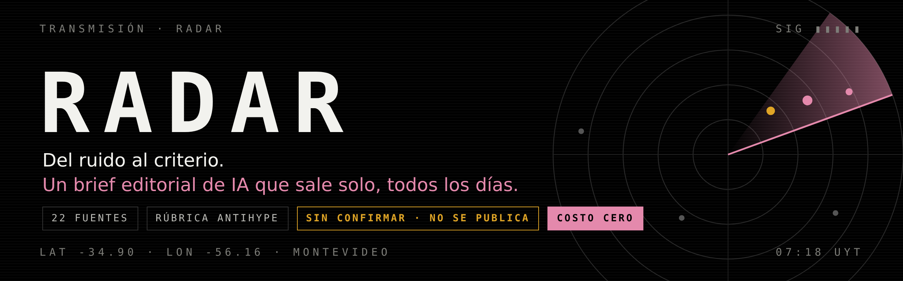
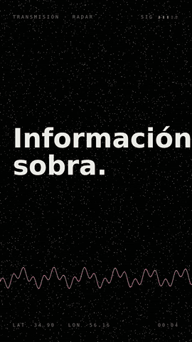
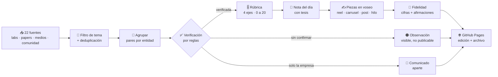
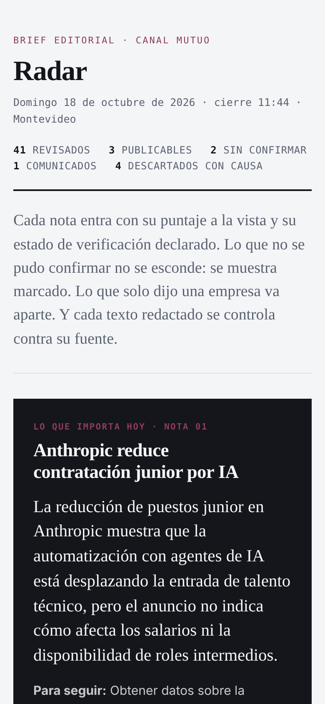
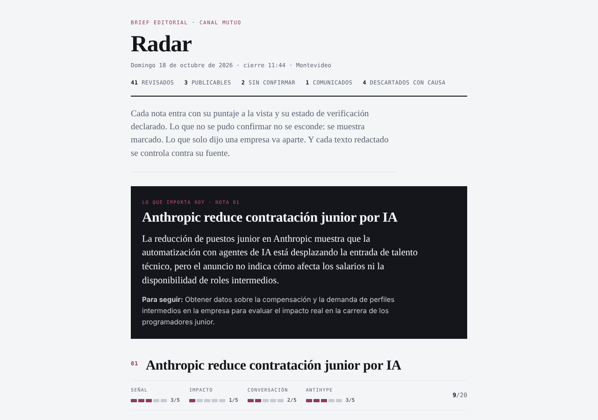

<p align="center">
  
</p>

<p align="center">
  <a href="https://github.com/federicoramos67/Radar-Mutuo/actions/workflows/radar.yml"></a>
  <a href="https://federicoramos67.github.io/Radar-Mutuo/"></a>
  
  
  
  <a href="LICENSE"></a>
  
</p>

<h3 align="center">
  <a href="https://federicoramos67.github.io/Radar-Mutuo/">📡 Ver la edición de hoy</a>
  &nbsp;·&nbsp;
  <a href="media/radar-promo.mp4">🎬 Video (32 s)</a>
  &nbsp;·&nbsp;
  <a href="media/radar-presentacion.pdf">🎞️ Presentación</a>
</h3>

---

> **No falta información. Falta criterio.**
> Cada día salen decenas de novedades de IA: lanzamientos, papers, rumores y cifras sin fuente. Radar las lee todas a las 7:18, separa la señal del ruido, **verifica con reglas que no dependen del modelo** y deja listas las piezas para que un equipo editorial solo tenga que decidir.

<table>
<tr>
<td width="34%" valign="top" align="center">

</td>
<td width="66%" valign="top">

### Qué hace, en una mañana

| Paso | Qué hace |
|---|---|
| 📥 **Lee** | 22 fuentes: laboratorios, papers, medios en inglés y en español, y comunidad |
| 🧹 **Filtra** | de las fuentes generales solo entra lo que es IA |
| 🔗 **Agrupa** | el código propone pares, el modelo decide si son el mismo hecho |
| ✅ **Verifica** | dos medios independientes, o fuente primaria con datos |
| 📣 **Separa** | lo que solo dijo una empresa va aparte, como comunicado |
| 🎚️ **Puntúa** | señal · impacto · conversación · antihype |
| 🧭 **Opina** | una nota del día con tesis editorial |
| ✍️ **Redacta** | reel, carrusel, post, hilo y preguntas para streaming, en voseo |
| 🔎 **Controla** | cada cifra y afirmación redactada contra su fuente |
| 🌐 **Publica** | una página fija + archivo histórico + datos en JSON |

**Lo descartado también se muestra, con su motivo.** Decir que no es trabajo editorial.

</td>
</tr>
</table>

## 🔍 La decisión que más importa: el modelo opina, el código verifica

Un modelo de lenguaje puede sonar seguro sin tener razón. Por eso el estado de cada nota lo calcula [`radar/verificacion.py`](radar/verificacion.py) con tres reglas que se pueden leer en voz alta:

| Situación | Estado | ¿Se publica? |
|---|---|---|
| La cuentan dos medios de dominios distintos | 🟢 **Verificada** (corroborada) | Sí |
| La publicó la empresa y la cubre al menos un medio | 🟢 **Verificada** (fuente primaria + cobertura) | Sí |
| Solo la empresa, y es un lanzamiento o paper con datos | 🟢 **Verificada** (fuente primaria) | Sí |
| Solo la empresa, y es un caso de cliente, promoción u opinión | 📣 **Comunicado** | No: va aparte hasta que un medio la cubra |
| Una sola fuente, o solo un agregador | 🟠 **Sin confirmar** | No: se muestra marcada y queda en observación |

El modelo informa qué tipo de nota es y ayuda a juntar las que cuentan lo mismo. La regla que la convierte en estado la aplica siempre el código. Y que dos redacciones independientes cubran una nota le sube el piso de señal y antihype: es la prueba más fuerte de que es un hecho.

## 🔎 Control de fidelidad: lo redactado dice solo lo que dice la fuente

Verificar que una noticia existe no alcanza: también hay que controlar que el texto que se escribe no le agregue nada. [`radar/fidelidad.py`](radar/fidelidad.py) trabaja en tres capas:

1. **Cifras (código).** Cada número, porcentaje o multiplicador ("triplica", "la mitad") de lo redactado tiene que aparecer en el material de la fuente.
2. **Frases de folleto (código).** Detecta hype ("revoluciona"), llamados a la acción vacíos y regionalismo forzado: el ángulo "en Uruguay" solo entra si la fuente tiene algo regional.
3. **Afirmaciones (modelo).** Una segunda lectura busca hechos que la fuente no sostiene. Recomendaciones y preguntas no cuentan.

Lo marcado se corrige una vez antes de publicar. Lo que sigue marcado aparece en la página como **"revisar antes de publicar"**, y cada pieza limpia lleva su sello ✓.

## 🧭 Cómo funciona



Todo corre en **GitHub Actions**, todos los días a las 07:18 de Montevideo. Si una fuente se cae, sigue con las demás y lo dice. Si el modelo no responde, igual publica con un puntaje de respaldo y lo avisa en la página.

## 🎚️ La rúbrica

Cada nota entra al brief con su puntaje a la vista. Cuatro ejes de 0 a 5:

| Eje | La pregunta |
|---|---|
| **Señal** | ¿Es un hecho nuevo y concreto, o es ruido, opinión o refrito? |
| **Impacto** | ¿Le cambia algo práctico a quien crea y trabaja con IA en la región? |
| **Conversación** | ¿Da para debate? ¿La gente va a querer opinar? |
| **Antihype** | ¿Se sostiene sin exagerar? 5 = datos verificables · 0 = puro marketing |

## 📱 Cómo se ve

<p align="center">
  
  &nbsp;
  
</p>

## 🧱 Cómo está hecho

| Pieza | Archivo |
|---|---|
| Fuentes, rúbrica y voz editorial | [`radar/config.py`](radar/config.py) |
| Lectura de RSS y Atom | [`radar/fuentes.py`](radar/fuentes.py) |
| Filtro, deduplicación y agrupación | [`radar/limpieza.py`](radar/limpieza.py) |
| Verificación cruzada y comunicados | [`radar/verificacion.py`](radar/verificacion.py) |
| Agrupación por pares, puntaje, nota del día y piezas | [`radar/editor.py`](radar/editor.py) |
| Control de fidelidad | [`radar/fidelidad.py`](radar/fidelidad.py) |
| Cliente del modelo, con reintentos y respaldo | [`radar/modelo.py`](radar/modelo.py) |
| Página del brief | [`radar/pagina.py`](radar/pagina.py) |
| Ejecución diaria y publicación | [`.github/workflows/radar.yml`](.github/workflows/radar.yml) |
| Pruebas | [`tests/test_radar.py`](tests/test_radar.py) |

- **Costo cero.** GitHub Actions (gratis en repositorios públicos) y el plan gratuito de [Groq](https://console.groq.com) (`openai/gpt-oss-120b`, con respaldo en Llama 3.3 70B). La key vive como secreto del repositorio, nunca en el código.
- **Cero dependencias.** Solo la biblioteca estándar de Python.
- **Cuida la cuota.** Puntúa las 30 historias más prometedoras del día, en lotes chicos y con pausas entre pedidos. Las fuentes que publican mucho tienen tope, para que no tapen al resto.
- **Consistente.** Temperatura cero para puntuar, agrupar y verificar: lo mismo, dos veces, da lo mismo. Más libertad solo para redactar.
- **Probado.** 31 pruebas corren antes de cada edición. Si una falla, ese día no se publica nada.
- **Transparente.** Cada edición guarda sus datos en [`docs/datos/`](docs/datos): todo lo revisado con su puntaje y estado, el informe de fidelidad y los errores del modelo si los hubo.

## 🚀 Tenerlo en tu cuenta

1. Hacé un **fork** de este repositorio.
2. Sacá una key gratis en [console.groq.com/keys](https://console.groq.com/keys).
3. En tu fork, andá a **Settings → Secrets and variables → Actions → New repository secret** y guardala con el nombre `GROQ_API_KEY`.
4. En **Settings → Pages**, elegí la rama `gh-pages` y tocá **Save**.
5. En **Actions → Radar diario → Run workflow**, corré la primera edición.

Para correrlo en tu computadora:

```bash
git clone https://github.com/federicoramos67/Radar-Mutuo && cd Radar-Mutuo && python -m unittest discover -s tests && GROQ_API_KEY=tu_key python -m radar
```

El brief queda en `docs/index.html`.

## 🎛️ Ajustarlo a tu medio

Todo lo editorial está en [`radar/config.py`](radar/config.py), sin tocar la lógica:

- `FUENTES`: agregá o sacá feeds y marcá cuáles son oficiales.
- `EJES` y `UMBRAL_PUBLICABLE`: la rúbrica y qué tan exigente es.
- `VOZ_MUTUO`: el tono en el que se redactan las piezas.

---

<p align="center">
  <b>Hecho por <a href="https://github.com/federicoramos67">Federico Ramos</a></b> · Montevideo, Uruguay<br>
  <sub>Propuesto como sistema editorial para Canal Mutuo. La máquina ordena, puntúa y justifica; las decisiones son humanas.</sub>
</p>
